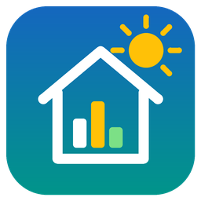

# Home EMS

Eigen energiemanagementsysteem voor Home Assistant: stuurt (straks) de Quatt-warmtepomp via tado, de Quatt Chill, witgoed via slimme stekkers, de Alfen-laadpaal en later een thuisbatterij, op basis van zonne-opwek en dynamische prijzen.

Het ontwerp staat in Obsidian (`Projects/Energie/EMS ontwerp.md`, alleen de actuele stand); de versiegeschiedenis en de eerste analyses staan daar in de map `Archief`.

## Status: versie 0.10.7 – Home EMS stuurt de woonkamer

Home EMS bepaalt wanneer de warmtepomp draait en schrijft het setpoint van de woonkamer, zodra je de schakelaar *Sturing* aanzet (standaard uit). Zolang die uit staat, schrijft Home EMS niets en laat het alleen zien wat het **zou** doen. Slaapkamers, PV-aftoppen en witgoed staan nog in schaduwmodus: ze worden berekend, maar niet geschakeld.

| Entiteit | Betekenis |
|---|---|
| `sensor.home_ems_advice` | `run`, `keep_running`, `running`, `wait` of `unknown`, met de reden als attribuut; bij `run` ook `setpoint_hint` (woonkamer + 0,2 °C) |
| `binary_sensor.home_ems_heat_pump_running` | warmtepomp draait (vermogen > 100 W) |
| `binary_sensor.home_ems_price_peak` | het huidige kwartier hoort bij de duurste 25% van de dag (ochtend- of avondpiek; sinds v0.4.5, daarvoor het vaste avondvenster `peak_window`) |
| `sensor.home_ems_floor_margin` | flowmetertemperatuur min woonkamertemperatuur (K), alleen als de warmtepomp stilstaat |
| `sensor.home_ems_pv_surplus` | teruglevering op dit moment (W) |
| `sensor.home_ems_runs_today` / `short_runs_today` | aantal runs en runs korter dan 30 min vandaag |

Advieslogica: buiten een prijspiek een run als de vloermarge onder 0 K komt (het vloerwater kouder dan de woonkamer; sinds v0.4.4, daarvoor 0,5 K) **en de woonkamer onder 19,5 °C is** (comfortsetpoint 19,0 °C + 0,5 °C, sinds v0.2.1), of bij ≥ 700 W PV-overschot zolang de vloermarge onder 3 K ligt; een lopende run korter dan 30 min hoort door te lopen. In een prijspiek (de duurste kwartieren van de dag volgens de prijssensor, instelbaar onder *Configureren*) adviseert Home EMS geen start, behalve als de vloermarge meer dan 1 K onder de grens zakt. Zonder prijsdata is er geen piek. Zakt de woonkamer of de keuken onder het comfortminimum (standaard 18 °C), dan is er altijd een run nodig, ook in een prijspiek (sinds v0.5; de keuken is daarbij alleen een meetpunt). Is er een debietsensor gekozen, dan telt de vloermarge alleen als de vloerpomp rondpompt (≥ 100 L/u); stilstaand water zegt niets over de vloer. Een run start je het zuinigst met een setpoint net boven de woonkamer (`setpoint_hint`): tado laat de warmtepomp dan op laag toerental draaien, met een hogere COP dan bij een grote stap. Bij een eerder opgeslagen instelling blijft de oude minimale vloermarge staan; pas die aan onder *Configureren → Planner en advies*.

### Gewenst setpoint en het schakelpunt (sinds v0.10.5)

Home EMS bepaalt het schakelpunt; de thermostaat en de warmtepomp voeren alleen uit. Er zijn twee toestanden en niets ertussenin:

- **Uit:** het setpoint staat op het minimum min de *uit-marge* (standaard 0,5 °C). De thermostaat vraagt dan geen warmte; alleen als Home EMS of Home Assistant uitvalt, is hij het vangnet.
- **Aan:** Home EMS start een run met de woonkamer + 0,2 °C. Daarna beweegt het setpoint **alleen omhoog** mee met de kamer (+ 0,1 °C). Zakt de kamer in het begin van een run nog even (het water en de vloer warmen eerst op), dan blijft het setpoint staan.
- **Stop:** komt de kamer op de bovengrens, dan gaat het setpoint in één keer naar het uit-niveau. Een setpoint gelijk aan de kamer blijft nooit staan, want dan bepalen de thermostaat en de warmtepomp zelf wanneer ze aan en uit gaan.

**Grenzen per dagdeel**

| | Ondergrens (Home EMS start zelf een run, + 0,1 °C) | Bovengrens (de run stopt) |
|---|---|---|
| Overdag | comfortsetpoint | comfortsetpoint + *plafond* (standaard 0,5 °C) |
| Bij zonne-overschot of een lage prijs | comfortsetpoint | comfortmaximum |
| In het nachtvenster | *minimum woonkamer 's nachts* | nachtplafond (0 = minimum + startband) |
| Altijd | comfortminimum in de woonkamer of de keuken: altijd een run, ook in een prijspiek | – |

**Volgorde** (de eerste die geldt, bepaalt het setpoint):

1. **EMS uit** (`switch.home_ems_ems_enabled`): geen setpoint, het schema van de thermostaat is leidend.
2. **Comfortminimum** (woonkamer of keuken), daarna de **vloerregel**: run starten.
3. **Minimale runtijd** (standaard 30 min, instelbaar): een gestarte run loopt minstens zo lang, ook voorbij de bovengrens.
4. **Slaapkamer** vlak voor bedtijd nog te koud: een korte run (zie *Slaapkamers*).
5. **Minimum woonkamer** (bron `minimum`): de kamer staat op de ondergrens van het dagdeel.
6. **Zon** (bron `pv`): een run start als het overschot **gemiddeld over 5 minuten** boven de drempel zit, de zonverwachting voor het komende uur nog overschot geeft, en de kamer minstens de startband onder het comfortmaximum zit. Een lopende run blijft doorlopen zolang er teruggeleverd wordt, tot het comfortmaximum.
7. **Planner**: een geplande run start alleen als de kamer minstens de **startband** (standaard 0,3 °C) onder de bovengrens zit, zodat hij ruimte heeft om te klimmen en lang duurt.
8. **Doorlopen tot de bovengrens** (bron `to_top`): een run stopt niet als zijn geplande blok voorbij is, maar pas bovenaan; behalve in een prijspiek.
9. **Uit** (bron `idle`).

**Zonneboost.** Tijdens een run met teruglevering gaat het gat tussen setpoint en kamer (waarop de thermostaat moduleert) om de 5 minuten 0,1 °C omhoog zolang er gemiddeld meer dan de *marge* (standaard 300 W) teruggaat, tot het *grootste gat*. Komt er gemiddeld meer dan de marge van het net, dan halveert de verhoging, en die gaat ook weer van het setpoint af. Het overschot is de teruglevering plus wat de draaiende warmtepomp en de batterijen (optioneel, onder *Opnieuw configureren*) gebruiken, nooit meer dan de PV-productie. De boost blijft bewaard bij het opslaan van de opties en bij een korte herstart.

**Vast tarief.** Vul onder *Zon en prijs* bij *Dynamisch contract vanaf* de eerste dag van een contract met kwartierprijzen in. Vóór die datum doet de prijs er niet toe: er is geen prijspiek en geen boost bij een lage prijs, en de planner plant alleen op de COP (de warmste uren). Leeg = prijzen tellen mee.

**Nacht.** In het nachtvenster start alleen het nachtminimum een run; de planner start er geen. In de laatste 2,5 uur van de nacht loopt een run door tot het comfortsetpoint (het niveau waarmee de dag begint), niet hoger. Een run die bij het begin van de nacht nog loopt, krijgt de nachtgrens zodra hij zijn minimale runtijd heeft gehad.

**Als de thermostaat of Home Assistant wegvalt.** De thermostaat houdt dan zelf zijn laatste setpoint vast. Stond dat op het uit-niveau, dan stookt hij alleen als vangnet; liep er net een run, dan regelt hij zelf op dat setpoint tot de verbinding terug is. Is de thermostaat langer dan 10 minuten onbereikbaar terwijl de sturing aan staat, dan zet Home EMS een melding in Home Assistant en schrijft het niets tot hij terug is; daarna schrijft het meteen het gewenste setpoint.

**Lage prijs.** Op of onder de lage prijs (all-in, standaard € 0,20/kWh, 0 = uit) is het gat meteen het grootste gat en is de bovengrens het comfortmaximum (niet in het nachtvenster).

| Entiteit | Betekenis |
|---|---|
| `sensor.home_ems_target_setpoint` | het setpoint dat Home EMS zet of zou zetten; attributen `source` (`off`, `unknown`, `comfort_min`, `floor`, `keep_running`, `bedroom`, `minimum`, `pv`, `planner`, `to_top`, `idle`), `reason`, `current_setpoint`, `would_write`, `boost` (`solar surplus` / `low price`), `boost_k` (hoeveel het gat verhoogd is), `ceiling` (bovengrens nu), `night` en `mode` (`control` met de sturing aan, anders `shadow`) |
| `switch.home_ems_ems_enabled` | EMS aan of uit |
| `sensor.home_ems_negative_price_export_today` | teruglevering vandaag terwijl de marktprijs negatief was (kWh); bij een dynamisch contract kost dat geld |

### Slaapkamers (v0.7, schaduwmodus)

Radiatorthermostaten in de slaapkamers openen alleen een klep: warm water stroomt pas als de woonkamer warmte vraagt. Home EMS bepaalt per kamer het setpoint:

- **Buiten het avondvenster** (standaard 6 uur vóór bedtijd tot bedtijd): het minimum (standaard 13 °C), de klep blijft dicht.
- **In het avondvenster, tijdens een run** (gepland, op zon, vloer, minimale looptijd): het doel van de kamer, zodat de kamer meewarmt in een run die er toch al is.
- **Vlak voor bedtijd** (laatste 90 minuten) en de kamer meer dan 0,3 °C onder het doel: het doel, en de arbiter start een korte run in de woonkamer (bron `bedroom`), anders komt er geen warm water.
- Anders: het minimum.

Instellen onder *Configureren → Slaapkamers*, als YAML:

```yaml
- entiteit: climate.slaapkamer_1
  naam: Slaapkamer 1
  doel: 17
  bedtijd: "20:00"
- entiteit: climate.slaapkamer_2
  naam: Slaapkamer 2
  doel: 17
  bedtijd: "22:00"
```

| Entiteit | Betekenis |
|---|---|
| `sensor.home_ems_bedrooms_open` | aantal kamers waarvan de klep nu open zou staan; attribuut `rooms` met per kamer `setpoint`, `reason`, `temperature` en `needs_run` |

De slaapkamers worden nog niet geschreven; de sturing (v0.6) schrijft alleen de woonkamer.

### Aftoppen en witgoed (v0.8, schaduwmodus)

**PV aftoppen.** Met een dynamisch contract kost teruglevering bij een negatieve marktprijs geld. Staat elke omvormer achter een eigen schakelaar, dan kan Home EMS ze één voor één uitzetten. In schaduwmodus laat het zien wat het zou doen:

- alleen bij een negatieve marktprijs (veld `market` van de prijssensor);
- een omvormer gaat pas uit als hij **minder levert dan de teruglevering** op dat moment (anders koop je stroom in, en inkoop kost ook bij een negatieve prijs nog energiebelasting); de kleinste eerst; beide als de teruglevering groter is dan beide samen;
- minstens 15 minuten uit, en terug aan zodra de prijs niet meer negatief is of na 4 uur.

`sensor.home_ems_pv_curtailment_inverters_off`: aantal omvormers dat uit zou staan, met `off`, `reason`, en de vermeden teruglevering vandaag (`avoided_export_kwh_today`, `avoided_cost_eur_today`). Kies onder *Configureren → Aftoppen en witgoed* het vermogen per omvormer (W).

**Witgoed.** Voor een vaatwasser of wasmachine achter een slimme stekker (machine laden, stekker uit; het programma loopt verder als de stroom terugkomt) berekent Home EMS de goedkoopste starttijd vóór de klaar-tijd, uit de prijs- en zonneverwachting:

```yaml
- naam: Vaatwasser
  kwh: 1.1
  duur: 2.5
  klaar_voor: "07:00"
```

`sensor.home_ems_best_appliance_start`: beste starttijd van het eerste apparaat; attribuut `appliances` met per apparaat `start`, `end`, `deadline`, `cost`, `cost_now` (direct starten), `saving` en `pv_share`. De stekker wordt nog niet geschakeld.

### Batterijreserve (v0.12)

Sommige thuisbatterijen voeden hun **backup-stopcontact uit de batterij zelf**, ook als er netstroom is. Hangt daar Home Assistant of het netwerk aan, dan loopt de batterij langzaam leeg zodra zijn ontlaadgrens het gewone ontladen stopt. Bij de harde ondergrens schakelt hij uit, en het stopcontact gaat mee. De batterijreserve laadt zo'n batterij **van het net bij** voor het zover is.

- **Start** als de laadtoestand op of onder het startniveau staat (standaard 15%) en de netmeter al minstens een minuut waarden geeft. Zonder net valt er niets te laden.
- **Stop** bij het stopniveau (standaard 24%), als de netmeter geen waarden meer geeft, als de schakelaar uit gaat, of na 3 uur laden zonder resultaat. Dat laatste geldt als storing: dan een uur geen nieuwe start.
- **Anti-flap:** na een stop minstens 15 minuten geen nieuwe start. De band tussen start en stop is de hysterese.
- **Laden:** externe sturing aan (bijvoorbeeld de RS485-modus), laadvermogen (standaard 1000 W; een batterij laadt rond 500–1500 W het zuinigst), *laden tot* het stopniveau (de batterij stopt dan zelf, ook zonder Home Assistant), geforceerde modus *charge*. Alleen wat nog niet goed staat wordt geschreven; staat de batterij tijdens het laden ineens anders, dan zet Home EMS hem terug.
- **Stoppen:** geforceerde modus *standby* en daarna externe sturing uit, zodat de batterij terug gaat naar zijn eigen werkmodus.
- **Vasthouden:** getallen die tijdens het laden op 0 gaan en daarna terug naar hun oude waarde. Bijvoorbeeld het maximale ontlaadvermogen van een tweede batterij, anders ontlaadt die in deze batterij.
- Een lading die bezig is, blijft bewaard over een herstart, zodat Home EMS hem afmaakt of netjes stopt.

| Entiteit | Betekenis |
|---|---|
| `switch.home_ems_battery_reserve` | batterijreserve aan of uit (standaard **uit**) |
| `sensor.home_ems_battery_reserve_status` | `off`, `not_configured`, `idle` (boven het startniveau), `waiting`, `charging` of `error`; attributen `reason`, `start_soc`, `stop_soc`, `charge_power_w`, `charging`, `since`, `stopped_at` |

Instellingen onder *Configureren → Batterijreserve*: de laadtoestandsensor, de schakelaar voor externe sturing, de keuzelijst voor de geforceerde modus en de opties die laden en stoppen (standaard `charge` en `standby`), het getal voor het laadvermogen, optioneel het getal voor *laden tot*, de sensoren van de netmeter, de getallen om vast te houden, de start- en stopniveaus en het laadvermogen.

### Sturing (v0.6)

Met de schakelaar `switch.home_ems_control` (*Sturing (setpoint schrijven)*, standaard **uit**) schrijft Home EMS het gewenste setpoint naar de thermostaat in de woonkamer (`climate.set_temperature`).

- **Alleen bij een wijziging**, en voor dezelfde reden hooguit eens per 5 minuten (instelbaar).
- **Handmatig gewijzigd** (op de thermostaat of in de app): de sturing pauzeert 2 uur (instelbaar) en gaat daarna verder.
- **EMS actief uit** of de sturing uit: het comfortsetpoint wordt één keer teruggezet, daarna schrijft Home EMS niets meer.
- **Geen data** (geen warmtepompvermogen of woonkamertemperatuur) langer dan 10 minuten: terug naar het comfortsetpoint.
- De stand van de schakelaar blijft bewaard over een herstart; bij het opstarten schrijft Home EMS niets.

**Voor je de sturing aanzet:** zet bestaande automatiseringen die het woonkamer- of keukensetpoint aanpassen (bijvoorbeeld een anti-pendelregeling of een vloerbewaking) uit, en zet een tweede thermostaat die via de woonkamer warmte vraagt laag. Anders sturen twee partijen dezelfde thermostaat.

| Entiteit | Betekenis |
|---|---|
| `switch.home_ems_control` | sturing aan of uit |
| `sensor.home_ems_control_status` | `off`, `steady` (setpoint klopt), `writing`, `waiting`, `override` (gepauzeerd), `fallback` of `error`; attributen `reason`, `last_written`, `last_write`, `last_source`, `override_until` |
| `sensor.home_ems_setpoint_writes_today` | aantal setpointwijzigingen vandaag |

Instellingen onder *Configureren → Sturing*: de pauze na een handmatige wijziging en de minimale tijd tussen twee wijzigingen.

### Advies vergelijken met de werkelijkheid (v0.2)

| Entiteit | Betekenis |
|---|---|
| `sensor.home_ems_run_advised` | 1 als het EMS nu een run adviseert, anders 0. Het 5-minutengemiddelde is het aandeel van de tijd dat een run geadviseerd werd. |
| `sensor.home_ems_advised_run_minutes_today` | minuten dat het EMS een run adviseerde terwijl de warmtepomp uit stond |
| `sensor.home_ems_unadvised_starts_today` | echte starts terwijl het EMS vlak daarvoor "wachten" adviseerde |
| `sensor.home_ems_running_minutes_today` | draaiminuten van de warmtepomp |
| `sensor.home_ems_pv_running_minutes_today` | draaiminuten terwijl het huis terugleverde (warmtepomp volledig op PV) |

De tellers en een lopende run blijven bewaard over een herstart van HA (binnen dezelfde dag). Een run die al liep toen Home EMS opstartte, telt niet als start. Intervallen langer dan 5 minuten (bijvoorbeeld tijdens een herstart) tellen niet mee.

### Dagplanner (v0.3)

De planner rekent uit hoeveel warmte het huis tot het einde van de prijsdata (max. 36 uur) nodig heeft, en zet die run-uren in de goedkoopste kwartieren. De arbiter (hierboven) beslist of een geplande run echt start. Nog niet in de planner: de grenzen per dagdeel en vooruit starten.

- **Warmtevraag:** graaduren uit de temperatuurverwachting × 0,217 kWh, min 5,3 kWh per dag (model uit de data van 14–23 okt 2026).
- **Warmte per run-uur** (sinds v0.10.5): *warmte bij 0 °C buiten* min *minder per °C warmer* × de buitentemperatuur (standaard 2,9 kW en 0, dus overal gelijk). Een warmtepomp die meer levert, krijgt minder en langere runs.
- **Kosten per kWh warmte** per kwartier: de stroomprijs (of, bij PV-overschot boven het basisverbruik, de gemiste terugleververgoeding = marktprijs), gedeeld door de COP bij de buitentemperatuur (COP ≈ 3,5 + 0,15 × T, tussen 2,5 en 7).
- **Gas** (sinds v0.8, optioneel): met een gasprijssensor (all-in per m³, bijvoorbeeld de gasprijs van Jeroen.nl) vergelijkt de planner per kwartier de kosten van warmte uit de warmtepomp (prijs ÷ COP) met die uit de ketel (gasprijs ÷ (9,77 kWh/m³ × 90%)). Waar de ketel goedkoper is (vorst, prijspiek), rekent de planner dat kwartier tegen de gaskosten, zonder stroom: de warmtepomp kiest zelf tussen compressor en ketel, maar alleen als de thermostaat warmte vraagt. Home EMS blijft daar dus gewoon warmte vragen als dat nodig is (sinds v0.8.1; in v0.8.0 werden zulke kwartieren overgeslagen). Attributen `gas_cost_per_kwh_heat` en `gas_cheaper_quarters` op *Volgende geplande run*.
- **Stand van het huis** (sinds v0.5): staat de woonkamer onder het comfortsetpoint, dan komt er warmte bij (warmtecapaciteit × verschil, standaard 15 kWh/K, maximaal 2 K); staat hij erboven, dan gebruikt de planner eerst die opgeslagen warmte. Alleen in het stookseizoen. Het attribuut `state_kwh` toont dat deel.
- **Doorlopen in de kou** (sinds v0.9): pauzes tussen geplande runs die korter zijn dan de *kortste pauze* (standaard 2 uur) worden opgevuld, zodat de runs samen één lange run worden. Bij kou ligt de warmtevraag dicht bij wat één warmtepomp op laag vermogen levert; doorlopen is dan veel zuiniger dan stoppen en opnieuw starten (een herstart gaat vaak op hoog vermogen, bij een duo soms met beide warmtepompen tegelijk, met een lagere COP).
- **Comfort:** runs van minimaal een uur, en nooit langer dan de ingestelde tijd (standaard 8 uur) zonder run. In de zomer, zonder warmtevraag, wordt er niets gepland.
- **Pieken:** geen vast venster meer (sinds v0.4.5). De prijs per kwartier bevat de ochtend- en avondpiek al, dus de goedkoopste blokken vermijden die vanzelf; een goedkope avond wordt gewoon gebruikt.
- **Databronnen** (in te stellen via *Configureren*): de stroomprijssensor van [Jeroen.nl](https://github.com/JorisBr-NL/ha-jeroen-nl) (attribuut `prices`, inclusief de prijsvoorspelling; voor de prijspiek in het advies het attribuut `today`, alle kwartieren van vandaag), de opwekvoorspelling van Jeroen.nl (attribuut `hours`) en een weerentiteit met een verwachting per uur. Zonder weerentiteit gebruikt de planner de huidige buitentemperatuur.

| Entiteit | Betekenis |
|---|---|
| `sensor.home_ems_volgende_geplande_run` | starttijd van de volgende (of lopende) geplande run; attributen `end`, `reason` (`cheapest` / `max_gap`), `pv_share`, `run_hours`, `heat_need_kwh`, `expected_cost`, `baseline_cost` en de lijst `runs` |
| `sensor.home_ems_geplande_warmtevraag` | warmtevraag tot het einde van de planning (kWh) |
| `sensor.home_ems_geplande_stookkosten` | verwachte stroomkosten van de planning (EUR); `baseline_cost` is dezelfde warmte tegen de gemiddelde kosten, `savings` het verschil |
| `binary_sensor.home_ems_run_gepland_nu` | aan als de planner nu een run heeft gepland |
| `sensor.home_ems_status_planner` (diagnostisch) | `ok`, `no_temperature_forecast` (plan zonder temperatuurverwachting, met de huidige buitentemperatuur) of `no_price_data` |

Tijden in de attributen staan in de tijdzone van Home Assistant. In nieuwere versies van Home Assistant zie je de attributen via ⋮ → *Attributen* in het venster van de sensor, of via *Ontwikkelhulpmiddelen → Statussen*.

Het attribuut `plan_says_run` op *Advies* laat zien of de planner en het regelgebaseerde advies het eens zijn.

### Dashboardkaart: plan van de warmtepomp

Paarse blokken zijn de geplande runs, grijze blokken wanneer de warmtepomp echt draaide, gele kolommen de zonverwachting per uur en de rode lijn de stroomprijs (vastgesteld plus voorspelling). Vereist [apexcharts-card](https://github.com/RomRider/apexcharts-card) en de [Jeroen.nl](https://github.com/JorisBr-NL/ha-jeroen-nl)-integratie. Controleer de entity-ID's via **Instellingen → Entiteiten**.

```yaml
type: custom:apexcharts-card
header:
  show: true
  title: Plan warmtepomp
  show_states: false
graph_span: 48h
span:
  start: day
now:
  show: true
  label: Nu
apex_config:
  chart:
    height: 320
  legend:
    show: true
    position: top
  dataLabels:
    enabled: false
  tooltip:
    shared: true
    x:
      format: "dd MMM HH:mm"
  xaxis:
    labels:
      datetimeFormatter:
        hour: "HH:mm"
yaxis:
  - id: price
    decimals: 2
    apex_config:
      title:
        text: "€/kWh"
  - id: pv
    opposite: true
    min: 0
    decimals: 1
    apex_config:
      title:
        text: "kW zon"
  - id: run
    show: false
    min: 0
    max: 1
series:
  - entity: sensor.home_ems_volgende_geplande_run
    name: Gepland
    yaxis_id: run
    type: area
    curve: stepline
    color: "#7e57c2"
    opacity: 0.35
    stroke_width: 0
    show:
      legend_value: false
      in_header: false
    data_generator: |
      const pts = [];
      for (const r of (entity.attributes.runs || [])) {
        pts.push([new Date(r.start).getTime(), 1]);
        pts.push([new Date(r.end).getTime(), 0]);
      }
      return pts.sort((a, b) => a[0] - b[0]);
  - entity: binary_sensor.home_ems_warmtepomp_draait
    name: Draaide
    yaxis_id: run
    type: area
    curve: stepline
    color: "#9e9e9e"
    opacity: 0.3
    stroke_width: 0
    transform: "return x === 'on' ? 1 : 0;"
    show:
      legend_value: false
      in_header: false
  - entity: sensor.jeroen_nl_opwekvoorspelling_vandaag
    name: Zon (verwachting)
    yaxis_id: pv
    type: column
    color: "#fbc02d"
    opacity: 0.6
    show:
      legend_value: false
      in_header: false
    data_generator: |
      return (entity.attributes.hours || [])
        .map(h => [new Date(h.start).getTime() + 30 * 60 * 1000, h.kwh]);
  - entity: sensor.jeroen_nl_stroomprijs
    name: Stroomprijs
    yaxis_id: price
    type: line
    curve: stepline
    stroke_width: 2
    color: "#e53935"
    show:
      legend_value: false
      in_header: false
    data_generator: |
      const now = Date.now();
      const past = (entity.attributes.today || [])
        .filter(p => new Date(p.start).getTime() < now);
      return [...past, ...(entity.attributes.prices || [])]
        .map(p => [new Date(p.start).getTime(), p.price]);
```

Het plan (paars) loopt vanaf nu; wat er eerder gebeurde, zie je aan de grijze blokken.

### Dashboardkaart: gewenst setpoint en sturing

Bovenaan de schakelaars en de status (zonder kopschakelaar, die zou ook *Sturing* aanzetten), daaronder een grafiek van 24 uur: de oranje trap is het gewenste setpoint van Home EMS, de blauwe trap het echte setpoint van de thermostaat, de groene lijn de woonkamertemperatuur en grijze blokken wanneer de warmtepomp draaide. In schaduwmodus zie je zo of Home EMS hetzelfde zou doen als je huidige regeling; met de sturing aan liggen oranje en blauw over elkaar. Vereist [apexcharts-card](https://github.com/RomRider/apexcharts-card). Vervang `climate.woonkamer` door je eigen thermostaat en controleer de entity-ID's via **Instellingen → Entiteiten** (ze volgen de taal van Home Assistant bij het installeren).

```yaml
type: vertical-stack
cards:
  - type: entities
    title: Home EMS
    # no header toggle: it would switch all switches at once, control included
    show_header_toggle: false
    entities:
      - entity: switch.home_ems_ems_actief
        name: EMS actief
      - entity: switch.home_ems_sturing_setpoint_schrijven
        name: Sturing actief
      - entity: sensor.home_ems_status_sturing
        name: Status sturing
        secondary_info: last-changed
      - entity: sensor.home_ems_gewenst_setpoint_woonkamer
        type: attribute
        attribute: source
        name: Bron gewenst setpoint
      - entity: sensor.home_ems_advies
        name: Advies
      - entity: sensor.home_ems_setpointwijzigingen_vandaag
        name: Setpointwijzigingen vandaag
  - type: custom:apexcharts-card
    header:
      show: true
      title: Setpoint woonkamer
      show_states: true
      colorize_states: true
    graph_span: 24h
    apex_config:
      chart:
        height: 280
      legend:
        show: true
        position: top
      tooltip:
        shared: true
        x:
          format: "dd MMM HH:mm"
    yaxis:
      - id: temp
        decimals: 1
        apex_config:
          title:
            text: "°C"
      - id: run
        show: false
        min: 0
        max: 1
    series:
      - entity: sensor.home_ems_gewenst_setpoint_woonkamer
        name: Gewenst (Home EMS)
        yaxis_id: temp
        curve: stepline
        color: "#ef6c00"
        stroke_width: 2
      - entity: climate.woonkamer
        attribute: temperature
        name: Setpoint thermostaat
        yaxis_id: temp
        curve: stepline
        color: "#1e88e5"
        stroke_width: 2
      - entity: climate.woonkamer
        attribute: current_temperature
        name: Woonkamer
        yaxis_id: temp
        color: "#43a047"
        stroke_width: 1
      - entity: binary_sensor.home_ems_warmtepomp_draait
        name: Warmtepomp draait
        yaxis_id: run
        type: area
        curve: stepline
        color: "#9e9e9e"
        opacity: 0.3
        stroke_width: 0
        transform: "return x === 'on' ? 1 : 0;"
        show:
          in_header: false
          legend_value: false
```

### Instellingen

Via **Instellingen → Apparaten en diensten → Home EMS → Configureren** kies je *Planner en advies*, *Sturing*, *Slaapkamers*, *Aftoppen en witgoed* of *Energie- en kostenoverzicht*. *Planner en advies* is verdeeld in secties met onder elk veld een korte uitleg: *Temperaturen overdag*, *Nacht*, *Runs*, *Zon en prijs*, *Vloer*, *Huis en warmtepomp (planner)* en *Bronnen*. Opslaan laadt Home EMS opnieuw; de waarden gelden direct. Entiteiten wisselen (bijvoorbeeld een andere thermostaat of de batterijen) gaat via ⋮ → *Opnieuw configureren*, zonder dat de opties verloren gaan.

### Energie- en kostenoverzicht (v0.4)

Vervangt een zelf bijgehouden Excel-overzicht. Home EMS leest elk uur de langetermijnstatistieken van HA (per dag) en maakt per maand en per **contractjaar** (zoals op de jaarafrekening: van de startdatum van een contract tot de dag voor het volgende contract, of per jaar vanaf de startdatum; met `jaren: kalender` bij een contract per kalenderjaar, handig bij maandelijkse facturering; een maand waarin het contract wisselt, wordt gesplitst):

- **meten:** gas, opwek, teruglevering, afname, afname − teruglevering, verbruik totaal / algemeen / warmtepomp / laadpaal, eigen verbruik % (= (opwek − teruglevering) / opwek), gemiddelde buitentemperatuur;
- **kosten:** vaste kosten, gas, stroom, totaal, voorschot, cumulatief totaal en voorschot, verwachte eindafrekening; apart uitbetaald: cashback en laadpaalvergoeding, en de netto kosten daarna;
- **voorspelling** voor de rest van het jaar: de lopende maand is werkelijk tot vandaag plus de voorspelling voor de resterende dagen. Opwek is de eigen opbrengst van die maand in eerdere jaren (anders een NL-profiel, geschaald op de eigen jaaropbrengst). Warmtepomp en gas komen uit een regressie op graaddagen over de laatste 12 volle maanden (sinds de warmtepomp er is), met normaaltemperaturen De Bilt 1991–2020. Algemeen verbruik is dezelfde maand eerder, met de trend van de laatste maanden. Laadpaal: de laatste volle maand. Met `leren_vanaf` (gas, warmtepomp, algemeen, opwek) leert de voorspelling pas vanaf een bepaalde maand; zijn dat er nog minder dan 6, dan geldt het gemiddelde per dag over die maanden.

Stroomkosten: tot en met `saldering_tot` per dag (afname − teruglevering) × tarief (mag negatief); levert een jaar netto meer terug dan het afneemt, dan krijgt dat overschot alleen de `teruglevering`-prijs (correctie in de laatste salderingsmaand van dat jaar). Daarna afname × inkoopprijs − teruglevering × terugleverprijs. Bij een dynamisch contract tellen de werkelijke kostenstatistieken (bijvoorbeeld van de Tibber-integratie), en de prijzen in de YAML zijn dan alleen de verwachting voor de voorspelling.

| Entiteit | Betekenis |
|---|---|
| `sensor.home_ems_year_cost_expected` | verwachte energiekosten op de rekening van de leverancier voor het lopende contractjaar (werkelijk + voorspelling); attribuut `net_costs` = na aftrek van cashback en laadpaalvergoeding; attributen `months` (de maandtabel), `years`, `from`, `to` en `contract` |
| `sensor.home_ems_settlement_expected` | verwachte eindafrekening: kosten − voorschotten (positief = bijbetalen) |
| `sensor.home_ems_month_cost_expected` | verwachte kosten van de lopende maand, met de maandregel als attributen |
| `sensor.home_ems_own_use_year` | eigen verbruik van zonnestroom dit jaar (%) |
| `sensor.home_ems_year_use_expected` | verwacht stroomverbruik dit jaar, met opwek, teruglevering, afname, warmtepomp, laadpaal en gas als attributen |
| `sensor.home_ems_overview_status` | `ok`, `not_configured`, `no_statistics` of `invalid_cost_settings` |

De entity-id's volgen de taal van HA bij het aanmaken (in het Nederlands bijvoorbeeld `sensor.home_ems_verwachte_energiekosten_dit_jaar`).

**Uitschieters:** een statistiek die even een onzinwaarde meldt (bijvoorbeeld een omvormer met een verkeerde dagtotaal), levert een dag met een enorme sprong op. Home EMS vervangt dagen die negatief zijn of boven 8 × de mediaan van die statistiek liggen (minimaal 100 per dag) door het gemiddelde van de dagen eromheen (3 dagen ervoor en erna), en toont ze in de attributen `skipped_days` van *Status overzicht*, zodat je ze in HA kunt corrigeren (Ontwikkelaarshulpmiddelen → Statistieken).

**Handmatige perioden:** voor maanden van vóór de HA-statistieken (of met foute statistieken) vul je onder `handmatig` de cijfers zelf in, per maand of per periode. Die vervangen de statistieken van die dagen. `temp` (gemiddelde buitentemperatuur) helpt de voorspelling van warmtepomp en gas.

**CSV:** als er een map is ingesteld (standaard `/share/energie`), werkt Home EMS elk uur twee bestanden bij (alleen als de inhoud veranderd is), met puntkomma's en een decimale komma zodat Excel (NL) ze direct opent:
- `energy_overzicht_export.csv`: alle maanden van alle contractjaren, oudste eerst. De kolommen staan in de volgorde van een maandtabblad in Excel (Maand, Dagen, Status, Buitentemp gem °C, Gas m³, Opwek, Teruglevering, Afname, Afname − teruglevering, Verbruik totaal, Warmtepomp, Laadpaal, Algemeen, Eigen verbruik %, Saldering (ja/nee), Vaste kosten, Gas €, Stroom €, Totaal €, Voorschot €, Cum totaal €, Cum voorschot €, Vergoeding laadpaal €/kWh, Retour laadpaal €), zodat je een maand in één keer kunt overplakken. Status is *werkelijk*, *lopend* of *verwachting*; de cumulatieve kolommen beginnen elk contractjaar opnieuw.
- `energy_overzicht_jaren.csv`: één regel per contractjaar met de totalen.

Tot v0.4.4 heette het maandbestand `energy_overzicht_JJJJ.csv` (één per jaar); die oude bestanden worden niet meer bijgewerkt en kun je weggooien.

**Instellen:** *Configureren* → *Energie- en kostenoverzicht*. Kies de sensoren (dezelfde als in het Energy-dashboard; voor de kostenvelden kun je ook een statistiek zonder sensor kiezen, zoals die van Tibber) en vul de contracten in als YAML:

```yaml
# prijzen all-in (incl. energiebelasting en btw); vast_per_dag = vaste kosten + netbeheer
# - vermindering energiebelasting, per dag
contracten:
  - naam: Vast contract
    vanaf: 2026-01-01
    stroom: 0.25
    teruglevering: 0.10   # per kWh netto-overschot onder saldering, en per kWh na saldering
    gas: 1.20
    vast_per_dag: 2.50    # incl. eventuele terugleverkosten, netbeheer en vermindering energiebelasting
  - naam: Dynamisch contract
    vanaf: 2027-02-01
    dynamisch: true
    stroom: 0.24          # verwachte gemiddelde inkoopprijs (alleen voor de voorspelling)
    teruglevering: 0.05   # verwachte gemiddelde terugleverprijs
    gas: 1.25
    vast_per_dag: 0.70
    korting_per_maand: 10 # korting op de maandfactuur (wordt per dag verrekend in de vaste kosten)
    jaren: kalender       # jaren tot 31 december in plaats van per contractjaar (standaard: contract)
saldering_tot: 2026-12-31
voorschotten:
  - vanaf: 2026-01-01
    bedrag: 150
  - vanaf: 2027-02-01     # maandelijkse facturering van de werkelijke kosten: geen voorschot
    bedrag: 0
laadpaal_vergoeding:      # per geladen kWh, apart uitbetaald (bijv. door de laadpaaloperator); staat als
                          # losse kolom in het overzicht, maar telt niet mee in de kosten of de afrekening
  - vanaf: 2026-01-01
    tot: 2026-06-30
    per_kwh: 0.35
cashback:                 # per contractjaar (jaar van de startdatum), apart uitbetaald: telt alleen mee in de netto kosten
  2026: 200
afrekening:               # werkelijke eindafrekening per contractjaar (jaar van de startdatum)
  2025: 1500
leren_vanaf:              # de voorspelling leert pas vanaf deze maand (bijv. na een verbouwing of
  gas: 2026-06-01         # een andere verandering); minder dan 6 maanden = gemiddelde per dag
handmatig:                # perioden zonder (goede) statistieken
  2025-12: {gas: 50, opwek: 150, teruglevering: 50, afname: 900, warmtepomp: 450, laadpaal: 0, temp: 5.0}
  2026-01-01/2026-01-15: {gas: 25, opwek: 60, teruglevering: 10, afname: 500, warmtepomp: 260, laadpaal: 0, temp: 3.0}
```

**Dashboardkaart** (Markdown-kaart; pas de entity-id aan):

```yaml
type: markdown
title: Energie dit jaar
content: >
  
  
  | Maand | Gas | Opwek | Terug | Afname | WP | Laadpaal | Totaal € | Cum € | Cum voorschot € |
  |---|--:|--:|--:|--:|--:|--:|--:|--:|--:|
  
  | {{ m.month }}{{ ' (' ~ m.days ~ ')' if m.days }}{{ ' *' if m.status != 'actual' }} | {{ m.gas_m3 | round(0) }} | {{ m.pv_kwh }} | {{ m.export_kwh }} | {{ m.import_kwh }} | {{ m.heat_pump_kwh }} | {{ m.ev_kwh }} | {{ m.total | round(0) }} | {{ m.cum_total | round(0) }} | {{ m.cum_advance | round(0) }} |
  

  \* = (deels) voorspelling. Verwachte kosten **€ {{ states(s) | round(0) }}**, voorschotten € {{ state_attr(s, 'advances') | round(0) }}, verwachte afrekening **€ {{ state_attr(s, 'expected_settlement') | round(0) }}**, netto na cashback en laadpaalvergoeding € {{ state_attr(s, 'net_costs') | round(0) }}, eigen verbruik {{ state_attr(s, 'own_use_pct') }}%.
```

## Installeren via HACS

1. HACS → Integraties → menu → *Custom repositories* → URL van deze repo, categorie *Integration*.
2. *Home EMS* installeren en Home Assistant herstarten.
3. Instellingen → Apparaten & diensten → *Integratie toevoegen* → *Home EMS*, en de entiteiten kiezen.

## Icoon

Het icoon in `custom_components/home_ems/brand/` (huis, zon en een kleine planningsgrafiek) is een eigen ontwerp voor deze integratie.

## Ontwikkelen

```bash
python -m pip install -r requirements_test.txt
python -m pytest
```

De rekenlogica staat in `model.py`, `planner.py` en `overview.py` (in `custom_components/home_ems/`) en heeft geen Home Assistant nodig, zodat die los te testen is.
