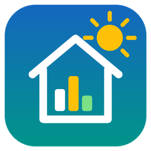

# Home EMS

Eigen energiemanagementsysteem voor Home Assistant: stuurt (straks) de Quatt-warmtepomp via tado, de Quatt Chill, witgoed via slimme stekkers, de Alfen-laadpaal en later een thuisbatterij, op basis van zonne-opwek en dynamische prijzen.

Het ontwerp staat in Obsidian (`Projects/Energie/EMS ontwerp.md`); de analyse waarop de standaardwaarden zijn gebaseerd in `Projects/Energie/Analyse runs en flowmeter.md`.

## Status: versie 0.4.2 – observatiemodus

Home EMS leest sensoren uit en laat zien wat het **zou** doen. Het schrijft niets naar apparaten; je bestaande automatiseringen blijven leidend.

| Entiteit | Betekenis |
|---|---|
| `sensor.home_ems_advice` | `run`, `keep_running`, `running`, `wait` of `unknown`, met de reden als attribuut |
| `binary_sensor.home_ems_heat_pump_running` | warmtepomp draait (vermogen > 100 W) |
| `binary_sensor.home_ems_peak_window` | binnen het avondvenster 17:30–20:00 |
| `sensor.home_ems_floor_margin` | flowmetertemperatuur min woonkamertemperatuur (K), alleen als de warmtepomp stilstaat |
| `sensor.home_ems_pv_surplus` | teruglevering op dit moment (W) |
| `sensor.home_ems_runs_today` / `short_runs_today` | aantal runs en runs korter dan 30 min vandaag |

Advieslogica: buiten het avondvenster een run als de vloermarge onder 0,5 K komt **en de woonkamer onder 19,5 °C is** (comfortsetpoint 19,0 °C + 0,5 °C, sinds v0.2.1), of bij ≥ 700 W PV-overschot zolang de vloermarge onder 3 K ligt; een lopende run korter dan 30 min hoort door te lopen.

### Advies vergelijken met de werkelijkheid (v0.2)

| Entiteit | Betekenis |
|---|---|
| `sensor.home_ems_run_advised` | 1 als het EMS nu een run adviseert, anders 0. Het 5-minutengemiddelde is het aandeel van de tijd dat een run geadviseerd werd. |
| `sensor.home_ems_advised_run_minutes_today` | minuten dat het EMS een run adviseerde terwijl de warmtepomp uit stond |
| `sensor.home_ems_unadvised_starts_today` | echte starts terwijl het EMS vlak daarvoor "wachten" adviseerde |
| `sensor.home_ems_running_minutes_today` | draaiminuten van de warmtepomp |
| `sensor.home_ems_pv_running_minutes_today` | draaiminuten terwijl het huis terugleverde (warmtepomp volledig op PV) |

De tellers en een lopende run blijven bewaard over een herstart van HA (binnen dezelfde dag). Een run die al liep toen Home EMS opstartte, telt niet als start. Intervallen langer dan 5 minuten (bijvoorbeeld tijdens een herstart) tellen niet mee.

### Dagplanner (v0.3)

De planner rekent uit hoeveel warmte het huis tot het einde van de prijsdata (max. 36 uur) nodig heeft, en zet die run-uren in de goedkoopste kwartieren. Ook dit is alleen advies: er wordt niets geschakeld.

- **Warmtevraag:** graaduren uit de temperatuurverwachting × 0,217 kWh, min 5,3 kWh per dag (model uit de data van 14–23 okt 2026). Eén run-uur levert ~2,9 kW warmte.
- **Kosten per kWh warmte** per kwartier: de stroomprijs (of, bij PV-overschot boven het basisverbruik, de gemiste terugleververgoeding = marktprijs), gedeeld door de COP bij de buitentemperatuur (COP ≈ 3,5 + 0,15 × T, tussen 2,5 en 7).
- **Comfort:** runs van minimaal een uur, en nooit langer dan de ingestelde tijd (standaard 8 uur) zonder run. In de zomer, zonder warmtevraag, wordt er niets gepland.
- **Avondpiek:** kwartieren in het avondpiekvenster (standaard 17:30–20:00) krijgen bij het kiezen € 0,05 per kWh warmte extra, zodat runs daar alleen vallen als het echt niet anders kan. In de verwachte kosten telt alleen de echte prijs.
- **Databronnen** (in te stellen via *Configureren*): de stroomprijssensor van [Jeroen.nl](https://github.com/JorisBr-NL/ha-jeroen-nl) (attribuut `prices`, inclusief de prijsvoorspelling), de opwekvoorspelling van Jeroen.nl (attribuut `hours`) en een weerentiteit met een verwachting per uur. Zonder weerentiteit gebruikt de planner de huidige buitentemperatuur.

| Entiteit | Betekenis |
|---|---|
| `sensor.home_ems_volgende_geplande_run` | starttijd van de volgende (of lopende) geplande run; attributen `end`, `reason` (`cheapest` / `max_gap`), `pv_share`, `run_hours`, `heat_need_kwh`, `expected_cost`, `baseline_cost` en de lijst `runs` |
| `sensor.home_ems_geplande_warmtevraag` | warmtevraag tot het einde van de planning (kWh) |
| `sensor.home_ems_geplande_stookkosten` | verwachte stroomkosten van de planning (EUR); `baseline_cost` is dezelfde warmte tegen de gemiddelde kosten, `savings` het verschil |
| `binary_sensor.home_ems_run_gepland_nu` | aan als de planner nu een run heeft gepland |
| `sensor.home_ems_status_planner` (diagnostisch) | `ok`, `no_temperature_forecast` (plan zonder temperatuurverwachting, met de huidige buitentemperatuur) of `no_price_data` |

Tijden in de attributen staan in de tijdzone van Home Assistant. In nieuwere versies van Home Assistant zie je de attributen via ⋮ → *Attributen* in het venster van de sensor, of via *Ontwikkelhulpmiddelen → Statussen*.

Het attribuut `plan_says_run` op *Advies* laat zien of de planner en het regelgebaseerde advies het eens zijn.

### Dashboardkaart: plan van de warmtepomp

Paarse blokken zijn de geplande runs, grijze blokken wanneer de warmtepomp echt draaide, gele kolommen de zonverwachting per uur en de rode lijn de stroomprijs (vastgesteld plus voorspelling). Vereist [apexcharts-card](https://github.com/RomRider/apexcharts-card) en de [Jeroen.nl](https://github.com/JorisBr-NL/ha-jeroen-nl)-integratie. Controleer de entity-ID's via **Instellingen → Entiteiten**.

```yaml
type: custom:apexcharts-card
header:
  show: true
  title: Plan warmtepomp
  show_states: false
graph_span: 48h
span:
  start: day
now:
  show: true
  label: Nu
apex_config:
  chart:
    height: 320
  legend:
    show: true
    position: top
  dataLabels:
    enabled: false
  tooltip:
    shared: true
    x:
      format: "dd MMM HH:mm"
  xaxis:
    labels:
      datetimeFormatter:
        hour: "HH:mm"
yaxis:
  - id: price
    decimals: 2
    apex_config:
      title:
        text: "€/kWh"
  - id: pv
    opposite: true
    min: 0
    decimals: 1
    apex_config:
      title:
        text: "kW zon"
  - id: run
    show: false
    min: 0
    max: 1
series:
  - entity: sensor.home_ems_volgende_geplande_run
    name: Gepland
    yaxis_id: run
    type: area
    curve: stepline
    color: "#7e57c2"
    opacity: 0.35
    stroke_width: 0
    show:
      legend_value: false
      in_header: false
    data_generator: |
      const pts = [];
      for (const r of (entity.attributes.runs || [])) {
        pts.push([new Date(r.start).getTime(), 1]);
        pts.push([new Date(r.end).getTime(), 0]);
      }
      return pts.sort((a, b) => a[0] - b[0]);
  - entity: binary_sensor.home_ems_warmtepomp_draait
    name: Draaide
    yaxis_id: run
    type: area
    curve: stepline
    color: "#9e9e9e"
    opacity: 0.3
    stroke_width: 0
    transform: "return x === 'on' ? 1 : 0;"
    show:
      legend_value: false
      in_header: false
  - entity: sensor.jeroen_nl_opwekvoorspelling_vandaag
    name: Zon (verwachting)
    yaxis_id: pv
    type: column
    color: "#fbc02d"
    opacity: 0.6
    show:
      legend_value: false
      in_header: false
    data_generator: |
      return (entity.attributes.hours || [])
        .map(h => [new Date(h.start).getTime() + 30 * 60 * 1000, h.kwh]);
  - entity: sensor.jeroen_nl_stroomprijs
    name: Stroomprijs
    yaxis_id: price
    type: line
    curve: stepline
    stroke_width: 2
    color: "#e53935"
    show:
      legend_value: false
      in_header: false
    data_generator: |
      const now = Date.now();
      const past = (entity.attributes.today || [])
        .filter(p => new Date(p.start).getTime() < now);
      return [...past, ...(entity.attributes.prices || [])]
        .map(p => [new Date(p.start).getTime(), p.price]);
```

Het plan (paars) loopt vanaf nu; wat er eerder gebeurde, zie je aan de grijze blokken.

### Instellingen (v0.3, v0.4)

Via **Instellingen → Apparaten en diensten → Home EMS → Configureren** kies je *Planner en advies* of *Energie- en kostenoverzicht*. Onder het eerste: de databronnen hierboven, comfortsetpoint, de band voor de vloerregel, minimale vloermarge, PV-overschot voor een run, minimale runtijd, het avondpiekvenster, de langste tijd zonder run en het basisverbruik van het huis. Wijzigingen gelden direct.

### Energie- en kostenoverzicht (v0.4)

Vervangt een zelf bijgehouden Excel-overzicht. Home EMS leest elk uur de langetermijnstatistieken van HA (per dag) en maakt per maand en per **contractjaar** (zoals op de jaarafrekening: van de startdatum van een contract tot de dag voor het volgende contract, of per jaar vanaf de startdatum; een maand waarin het contract wisselt, wordt gesplitst):

- **meten:** gas, opwek, teruglevering, afname, afname − teruglevering, verbruik totaal / algemeen / warmtepomp / laadpaal, eigen verbruik % (= (opwek − teruglevering) / opwek), gemiddelde buitentemperatuur;
- **kosten:** vaste kosten, gas, stroom, laadpaalvergoeding, totaal, voorschot, cumulatief totaal en voorschot, cashback, verwachte eindafrekening;
- **voorspelling** voor de rest van het jaar: de lopende maand is werkelijk tot vandaag plus de voorspelling voor de resterende dagen. Opwek is de eigen opbrengst van die maand in eerdere jaren (anders een NL-profiel, geschaald op de eigen jaaropbrengst). Warmtepomp en gas komen uit een regressie op graaddagen over de laatste 12 volle maanden (sinds de warmtepomp er is), met normaaltemperaturen De Bilt 1991–2020. Algemeen verbruik is dezelfde maand eerder, met de trend van de laatste maanden. Laadpaal: de laatste volle maand.

Stroomkosten: tot en met `saldering_tot` per dag (afname − teruglevering) × tarief (mag negatief); levert een jaar netto meer terug dan het afneemt, dan krijgt dat overschot alleen de `teruglevering`-prijs (correctie in de laatste salderingsmaand van dat jaar). Daarna afname × inkoopprijs − teruglevering × terugleverprijs. Bij een dynamisch contract tellen de werkelijke kostenstatistieken (bijvoorbeeld van de Tibber-integratie), en de prijzen in de YAML zijn dan alleen de verwachting voor de voorspelling.

| Entiteit | Betekenis |
|---|---|
| `sensor.home_ems_year_cost_expected` | verwachte energiekosten van het lopende contractjaar (werkelijk + voorspelling − cashback); attributen `months` (de maandtabel), `years`, `from`, `to` en `contract` |
| `sensor.home_ems_settlement_expected` | verwachte eindafrekening: kosten − voorschotten (positief = bijbetalen) |
| `sensor.home_ems_month_cost_expected` | verwachte kosten van de lopende maand, met de maandregel als attributen |
| `sensor.home_ems_own_use_year` | eigen verbruik van zonnestroom dit jaar (%) |
| `sensor.home_ems_year_use_expected` | verwacht stroomverbruik dit jaar, met opwek, teruglevering, afname, warmtepomp, laadpaal en gas als attributen |
| `sensor.home_ems_overview_status` | `ok`, `not_configured`, `no_statistics` of `invalid_cost_settings` |

De entity-id's volgen de taal van HA bij het aanmaken (in het Nederlands bijvoorbeeld `sensor.home_ems_verwachte_energiekosten_dit_jaar`).

**Uitschieters:** een statistiek die even een onzinwaarde meldt (bijvoorbeeld een omvormer met een verkeerde dagtotaal), levert een dag met een enorme sprong op. Home EMS vervangt dagen die negatief zijn of boven 8 × de mediaan van die statistiek liggen (minimaal 100 per dag) door het gemiddelde van de dagen eromheen (3 dagen ervoor en erna), en toont ze in de attributen `skipped_days` van *Status overzicht*, zodat je ze in HA kunt corrigeren (Ontwikkelaarshulpmiddelen → Statistieken).

**Handmatige perioden:** voor maanden van vóór de HA-statistieken (of met foute statistieken) vul je onder `handmatig` de cijfers zelf in, per maand of per periode. Die vervangen de statistieken van die dagen. `temp` (gemiddelde buitentemperatuur) helpt de voorspelling van warmtepomp en gas.

**CSV:** als er een map is ingesteld (standaard `/share/energie`), werkt Home EMS elk uur bij (alleen als de inhoud veranderd is, dus afgesloten jaren blijven ongemoeid) `energy_overzicht_JJJJ.csv` per jaar en `energy_overzicht_jaren.csv`, met puntkomma's en een decimale komma zodat Excel (NL) ze direct opent.

**Instellen:** *Configureren* → *Energie- en kostenoverzicht*. Kies de sensoren (dezelfde als in het Energy-dashboard; voor de kostenvelden kun je ook een statistiek zonder sensor kiezen, zoals die van Tibber) en vul de contracten in als YAML:

```yaml
# prijzen all-in (incl. energiebelasting en btw); vast_per_dag = vaste kosten + netbeheer
# - vermindering energiebelasting, per dag
contracten:
  - naam: Vast 2026
    vanaf: 2026-01-14
    stroom: 0.228
    teruglevering: 0.15   # per kWh netto-overschot onder saldering, en per kWh na saldering
    gas: 1.205
    vast_per_dag: 2.593   # incl. terugleverkosten, netbeheer en vermindering energiebelasting
  - naam: Tibber
    vanaf: 2027-01-16
    dynamisch: true
    stroom: 0.25          # verwachte gemiddelde inkoopprijs (alleen voor de voorspelling)
    teruglevering: 0.05   # verwachte gemiddelde terugleverprijs
    gas: 1.24
    vast_per_dag: 0.67
saldering_tot: 2026-12-31
voorschotten:
  - vanaf: 2026-01-14
    bedrag: 123
laadpaal_vergoeding:      # per geladen kWh, bijvoorbeeld van een werkgever
  - vanaf: 2025-12-01
    tot: 2026-08-31
    per_kwh: 0.40
cashback:
  2026: 390
afrekening:               # werkelijke eindafrekening per contractjaar (jaar van de startdatum)
  2025: 1854
handmatig:                # perioden zonder (goede) statistieken
  2025-12: {gas: 54, opwek: 161, teruglevering: 48, afname: 1386, warmtepomp: 539, laadpaal: 394, temp: 5.6}
  2026-01-01/2026-01-13: {gas: 38, opwek: 37, teruglevering: 5, afname: 871, warmtepomp: 447, laadpaal: 140, temp: 0.1}
```

**Dashboardkaart** (Markdown-kaart; pas de entity-id aan):

```yaml
type: markdown
title: Energie dit jaar
content: >
  
  
  | Maand | Gas | Opwek | Terug | Afname | WP | Laadpaal | Totaal € | Cum € | Cum voorschot € |
  |---|--:|--:|--:|--:|--:|--:|--:|--:|--:|
  
  | {{ m.month }}{{ ' (' ~ m.days ~ ')' if m.days }}{{ ' *' if m.status != 'actual' }} | {{ m.gas_m3 | round(0) }} | {{ m.pv_kwh }} | {{ m.export_kwh }} | {{ m.import_kwh }} | {{ m.heat_pump_kwh }} | {{ m.ev_kwh }} | {{ m.total | round(0) }} | {{ m.cum_total | round(0) }} | {{ m.cum_advance | round(0) }} |
  

  \* = (deels) voorspelling. Verwachte kosten **€ {{ states(s) | round(0) }}**, voorschotten € {{ state_attr(s, 'advances') | round(0) }}, verwachte afrekening **€ {{ state_attr(s, 'expected_settlement') | round(0) }}**, eigen verbruik {{ state_attr(s, 'own_use_pct') }}%.
```

## Installeren via HACS

1. HACS → Integraties → menu → *Custom repositories* → URL van deze repo, categorie *Integration*.
2. *Home EMS* installeren en Home Assistant herstarten.
3. Instellingen → Apparaten & diensten → *Integratie toevoegen* → *Home EMS*, en de entiteiten kiezen.

## Icoon

Het icoon in `custom_components/home_ems/brand/` (huis, zon en een kleine planningsgrafiek) is een eigen ontwerp voor deze integratie.

## Ontwikkelen

```bash
python -m pip install -r requirements_test.txt
python -m pytest
```

De rekenlogica staat in `model.py`, `planner.py` en `overview.py` (in `custom_components/home_ems/`) en heeft geen Home Assistant nodig, zodat die los te testen is.
